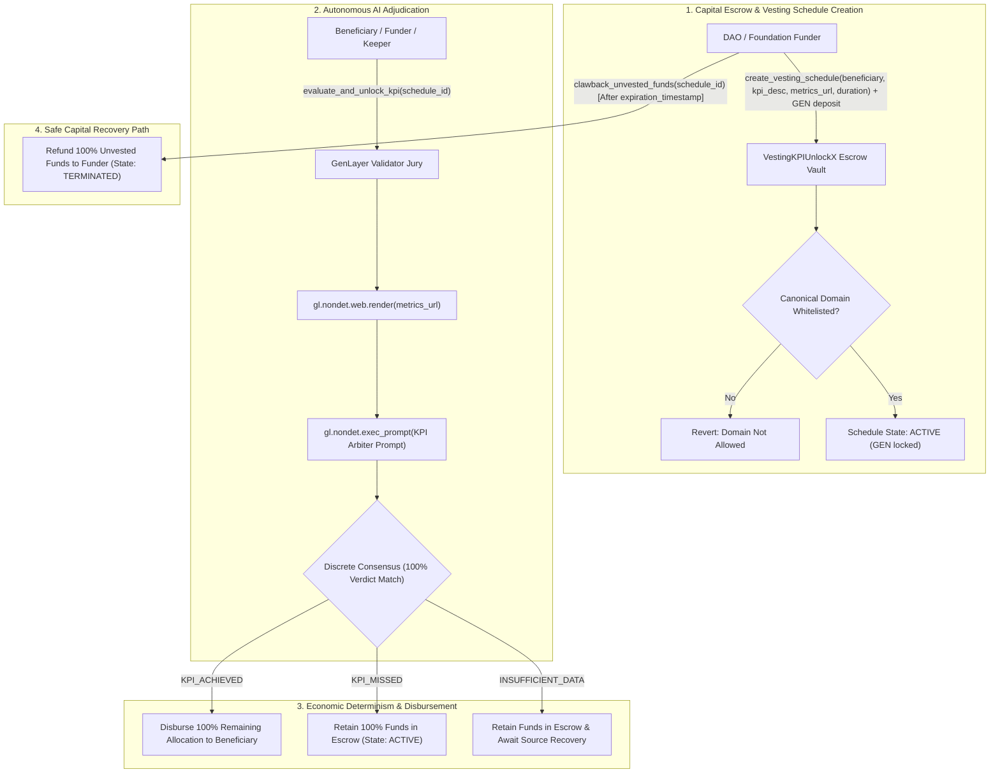

# VestingKPIUnlockX — Autonomous Milestone & Metric-Gated Fund Vesting Protocol

> **Track:** Autonomous Protocols / Future of Work  
> **Network:** GenLayer studionet (Chain ID: `61999` / `0xF1EF`)  
> **Target Environment:** [GenLayer Studio](https://studio.genlayer.com)  
> **Execution Engine:** GenVM / Optimistic Democracy Semantic Consensus  
> **Contract Source:** [`contracts/vesting_kpi_unlock_x.py`](contracts/vesting_kpi_unlock_x.py)  

---

## 1. Live Deployment & Verification

The **VestingKPIUnlockX** Intelligent Contract is deployed, finalized, and verified on GenLayer **studionet**:

- **CONTRACT_ADDRESS:** `0xb3243A58ef358E4AC87651eA6D99819ce307995f`
- **TRANSACTION_HASH:** `0x7911bd42af945d1a859ae2689004a23c35564f5105f4793ab887f4685606ecbf`
- **DEPLOYER_ADDRESS:** `0x0299Fe02B2a392680A79D032D6882317C6F0Df4A`
- **NETWORK:** `studionet` (Chain ID: `61999` / `0xF1EF`)
- **RPC_URL:** `https://studio.genlayer.com/api`
- **RECEIPT_STATUS:** `5` (FINALIZED)
- **RESULT:** `6` (SUCCESS)
- **Deployment Details:** [`deployment.json`](deployment.json)

---

## 2. Core Problem & The 1-Line Pitch

### The Core Problem
Traditional linear token and fund vesting protocols for founding teams, contractors, and grantees suffer from fundamental systemic flaws:
1. **Dumb Time-Based Unlocks:** Standard smart contracts (e.g., Sablier, Superfluid) unlock funds purely based on block timestamps (e.g. 10% unlocked every month). If a recipient abandons development, ships defective deliverables, or fails to acquire users, tokens continue dumping onto public markets regardless.
2. **Subjective DAO Voting Gridlock:** If DAOs manually vote to release funds upon each milestone, voting suffers from severe voter apathy, political nepotism, conflicts of interest, and weeks-long bureaucratic delays.
3. **Legacy Blockchain Blindness:** Solidity contracts cannot autonomously scrape analytics portals (DeFiLlama TVL, Dune Analytics queries, GitHub release tags, block explorer stats) or perform nuanced semantic auditing on unstructured qualitative or quantitative milestone claims.

### Why This Primitive DIES Without GenLayer (The 1-Line Pitch)
> *"Legacy blockchains cannot scrape live off-chain analytics portals or semantically audit metric thresholds on-chain; without GenLayer's native non-deterministic web rendering (`gl.nondet.web.render`) and LLM validator jury consensus (`gl.vm.run_nondet`), an autonomous, tamper-proof, metric-gated milestone vesting protocol is fundamentally impossible."*

---

## 3. Architecture & System Flow



---

## 4. Economic Determinism & Discrete Consensus Mechanics

### 1. 100% Discrete Consensus Binding
Standard LLMs produce slight stylistic variations when generating natural language explanations. **VestingKPIUnlockX** prevents consensus divergence while preserving explainability by enforcing **discrete semantic equivalence** inside `validator_fn`:

```python
def validator_fn(leader_res) -> bool:
    if not isinstance(leader_res, gl.vm.Return):
        return False
    leader = leader_res.calldata
    ...
    mine = leader_fn()
    # DISCRETE EQUIVALENCE: 100% agreement on exact KPI outcome
    return leader["verdict"] == mine["verdict"]
```

### 2. Tri-State Adjudication Matrix

| Classification Verdict | Adjudication Condition | Financial Disbursement |
|---|---|---|
| `KPI_ACHIEVED` | Verified metrics prove the milestone threshold has been achieved or surpassed (e.g. DeFiLlama TVL > $10M, GitHub release v2.0 live). | **100% Remaining Allocation Released to Beneficiary**, Schedule transitioned to `COMPLETED`. |
| `KPI_MISSED` | Data is valid and verified, but metric falls short of contractual KPI criteria. | **0 GEN Disbursed**. Capital remains safely locked in escrow (`ACTIVE`) awaiting future achievement. |
| `INSUFFICIENT_DATA` | Metric endpoint is down, returns 404, or provides ambiguous/corrupted responses. | **0 GEN Disbursed**. Capital remains protected in escrow; schedule remains `ACTIVE`. |

### 3. Canonical Domain Whitelist
To protect funders and DAOs from spoofed analytics endpoints, the contract validates all `metrics_url` hostnames against a strict whitelist:
- `defillama.com` / `api.llama.fi`
- `dune.com` / `api.dune.com`
- `github.com` / `api.github.com`
- `etherscan.io` / `api.etherscan.io`
- `mock-analytics.genlayer.com`
- Custom domains dynamically added by contract owner via `add_allowed_analytics_domain`

---

## 5. Contract API & Storage Layout

### State Storage
- `owner: Address`: Contract administrator address.
- `schedule_count: bigint`: Sequential counter of created vesting schedules.
- `schedules: TreeMap[str, VestingSchedule]`: Mapping of schedule IDs to schedule records.
- `custom_allowed_domains: TreeMap[str, bool]`: Dynamic domain whitelist records.

### Public Methods
- `create_vesting_schedule(beneficiary: Address, kpi_metric_description: str, metrics_url: str, duration_sec: int) -> str`: Funder locks native GEN and initiates a metric-gated vesting schedule.
- `evaluate_and_unlock_kpi(schedule_id: str) -> None`: Triggers autonomous web scraping, LLM jury evaluation, and fund disbursement.
- `clawback_unvested_funds(schedule_id: str) -> None`: Allows funder to safely recover unvested capital after schedule expiration.
- `add_allowed_analytics_domain(domain: str) -> None`: Owner adds trusted metrics verification domain.
- `remove_allowed_analytics_domain(domain: str) -> None`: Owner revokes trusted metrics verification domain.
- `is_analytics_domain_allowed(domain: str) -> bool`: View whitelist status of a given domain.
- `get_schedule(schedule_id: str) -> str`: Returns full JSON representation of schedule state.
- `get_current_time() -> int`: Returns current block/transaction timestamp.
- `get_schedule_count() -> int`: Returns total registered schedule count.
- `get_owner() -> str`: Returns contract owner hex address.

---

## 6. Comprehensive Test Suite & Verification Results

All 10 unit test suites passed with **100% success rate** using `pytest` and `genlayer-test`:

```bash
plugins: anyio-4.14.2, genlayer-test-0.29.2
collected 10 items

tests/test_vesting_kpi_unlock_x.py::test_initial_state_and_domain_management PASSED [ 10%]
tests/test_vesting_kpi_unlock_x.py::test_create_vesting_schedule_success PASSED [ 20%]
tests/test_vesting_kpi_unlock_x.py::test_create_vesting_schedule_validations PASSED [ 30%]
tests/test_vesting_kpi_unlock_x.py::test_evaluate_kpi_achieved_full_unlock PASSED [ 40%]
tests/test_vesting_kpi_unlock_x.py::test_evaluate_kpi_missed_funds_retained PASSED [ 50%]
tests/test_vesting_kpi_unlock_x.py::test_evaluate_kpi_insufficient_data_offline_or_404 PASSED [ 60%]
tests/test_vesting_kpi_unlock_x.py::test_clawback_unvested_funds_success PASSED [ 70%]
tests/test_vesting_kpi_unlock_x.py::test_clawback_unvested_funds_validations PASSED [ 80%]
tests/test_vesting_kpi_unlock_x.py::test_non_existent_schedule_operations PASSED [ 90%]
tests/test_vesting_kpi_unlock_x.py::test_view_methods PASSED             [100%]

============================= 10 passed in 11.76s =============================
```

---

## 7. Step-by-Step Studionet Deployment & Interaction Guide

### 1. Installation & Environment Setup
```bash
git clone https://github.com/tuannguyen1995/vesting-kpi-unlock-x.git
cd vesting-kpi-unlock-x
pip install -r requirements-dev.txt
cp .env.example .env
```

### 2. Running Local Contract Tests
```bash
pytest tests/test_vesting_kpi_unlock_x.py -v
```

### 3. Deploying to GenLayer Studionet
```bash
python scripts/deploy_studionet.py
```

### 4. Interacting on GenLayer Studio
1. Open [GenLayer Studio](https://studio.genlayer.com).
2. Connect your wallet to **studionet** (Chain ID: `61999`).
3. Load the deployed contract address: `0xb3243A58ef358E4AC87651eA6D99819ce307995f`.
4. Call `create_vesting_schedule` with allocation deposit, beneficiary address, KPI criteria, and canonical metrics URL.
5. Trigger `evaluate_and_unlock_kpi` to execute autonomous consensus and unlock funds!
